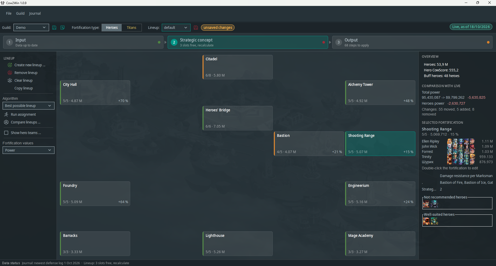

# Cow2Win

A desktop tool for the **Clash of Worlds** guild event in *Hero Wars: Dominion Era*.

In Clash of Worlds a guild has fewer defense slots than teams. Cow2Win helps
you find the strongest defense lineup: it decides which team defends which
fortification and which of the weakest teams are left out. It then shows
you, step by step, what to change in the game.

The app guides you through three steps: **Input** (guild and teams) →
**Strategic concept** (plan the lineup) → **Output** (apply it in the game).

## Features

- **Guild and teams** – members with their hero teams (heroes, pet, war flag)
  and titan teams (titans, totems), with templates for quick entry.
- **Automatic lineup** – several strategies for heroes and titans: HODOR
  (holds the gates first, the default), HODOR (CowScore), S.H.I.E.L.D
  (forward defense) and MAX_BUFF (biggest buff first). Teams can also be
  assigned or moved by hand.
- **CowScore** – rates how well a team fits a fortification. Adjustable in
  the settings.
- **Fortification map** – power and buff of every fortification at a glance.
  Compare and copy lineups.
- **Change plan** – the steps to get from the live in-game lineup to the new
  one, plus an HTML report.
- **Clash of Worlds Journal** (guild masters only) – import the battle logs
  exported in the game, browse past battles, replay them step by step and
  update your teams from them.
- German, English, French and Spanish; automatic backups; update check.
  The Spanish translation is new – feedback is welcome via
  [GitHub Issues](https://github.com/Cow2Win/Cow2Win/issues).
- **Manual** – *Help* → *Manual* (or F1) opens an English manual with FAQ inside the
  app, at the chapter of the current stage. You can also read it here:
  [manual.md](cow2win-app/src/main/resources/manual/manual.md).
- **New heroes and titans without a new version** – *File* → *Update game data …*
  downloads the latest game data (heroes, titans, pets, war flags,
  fortifications, their names and pictures), checks it and uses it from the
  next start on. Your guilds, lineups and CowScore settings stay as they are.

## Download

Get the latest Windows version from
[Releases](https://github.com/Cow2Win/Cow2Win/releases): unzip it and start
`Cow2Win.exe`. No separate Java installation is needed. On the first start a
demo guild shows how everything works: an anonymized real guild with its live
lineup, an optimized lineup to compare it with, and a Clash of Worlds Journal
with one example battle.

### Windows SmartScreen warning

Cow2Win is not code-signed, so on the first start Windows may show
"Windows protected your PC" (Microsoft Defender SmartScreen). Click
**More info** and then **Run anyway**.

To avoid the warning altogether: before unzipping, right-click the downloaded
zip, choose **Properties**, tick **Unblock** and click **OK**, then unzip it.

## License

Cow2Win is released under the MIT License, see [LICENSE](LICENSE).

Hero Wars and its artwork (hero, titan and pet pictures etc.) belong to their
owner and are not covered by this license. Cow2Win is a fan project and not
affiliated with the game's publisher.

Credits:

- [Phosphor Icons](https://phosphoricons.com) (MIT) – menu and toolbar icons
- [Material-UI-Swing](https://github.com/vincenzopalazzo/material-ui-swing) (MIT) – look and feel
- [Gson](https://github.com/google/gson) (Apache 2.0)
- [H2 Database](https://h2database.com) (MPL 2.0 / EPL 1.0)
